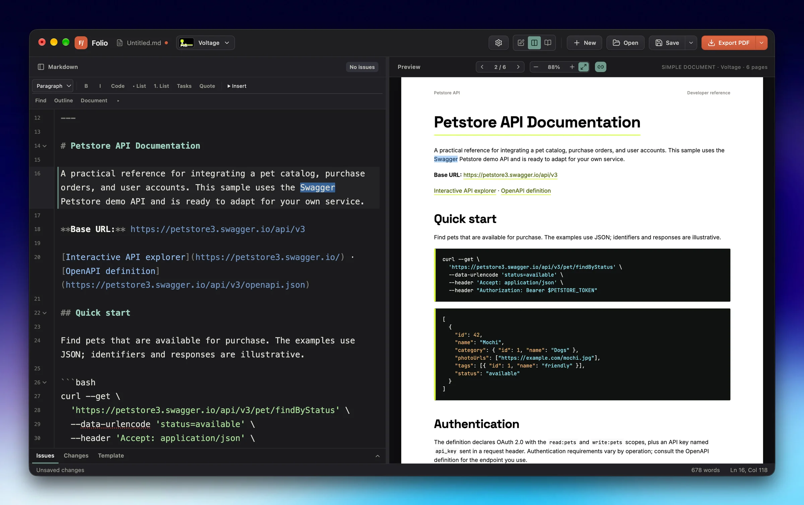
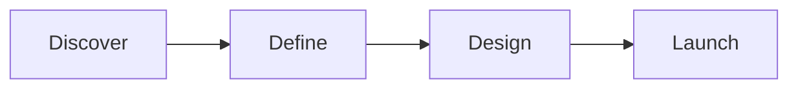
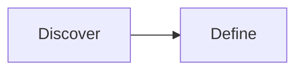

# Folio

Folio is a macOS-first Markdown document editor built with Electron, React, CodeMirror, and Paged.js. Markdown stays the source of truth while a separate branded template controls presentation.



Folio includes:

- Open, edit, save, and Save As local `.md` files, with optional autosave and external-change detection.
- Optional YAML front matter for SOW metadata.
- Live A4 page layout with realistic page boundaries and a visible Portrait/Landscape control.
- Seven bundled document themes, including Scientific for equations, with per-document color and typography overrides.
- A Scientific Article layout with a first-page title, authors, affiliations, abstract, keywords, and compact manuscript typography.
- Theme-aware Mermaid diagrams in preview and PDF output.
- PDF export through the same paginated component and stylesheet used by the preview, plus PNG page images and a stitched long image rasterized from the finished PDF.
- Native macOS window chrome, menus, keyboard shortcuts, and edited-document indicator.
- A welcome screen with starter templates and bundled samples (API documentation, pitch deck, and a two-column scientific paper), recent documents, save/discard prompts, and recovery of unsaved drafts.
- A document inspector for issues and revision comparison.

## Run locally

Requirements: macOS and Node.js 22.12 or newer.

```bash
pnpm install
pnpm dev
```

The Vite server and Electron application start together with a DEV-tagged icon. Use `⌘O` to open Markdown, `⌘S` to save, `⇧⌘S` to Save As, and `⇧⌘E` to export a PDF. On Windows/Linux, use Ctrl in place of Command.

## Build and verify

```bash
pnpm check
pnpm build
pnpm start
```

`pnpm build` creates the renderer in `dist/` and the Electron main/preload bundles in `dist-electron/`. Packaging commands are listed below.

The theme selector writes its choice into the Markdown front matter. Unsaved edits are kept as a local recovery draft and offered for restoration at the next launch.

Choose **Edit styles…** in the style picker, or open the inspector's **Style** tab, to choose fonts with live type samples and adjust the main colors. **More options** contains the detailed palette. **Duplicate style** copies the current style and edits; **New style** starts from a built-in style. Named styles and the active style are saved inside the `.folio` document. **Save style changes** updates the document's reusable style; saving the document persists the library. A Markdown draft with named styles offers a Folio save so the library is retained. Applied font and color values remain in frontmatter when exporting Markdown. Previously saved app styles remain available and are copied into a document when used.

## Editing tools

Use the toolbar above the Markdown editor for headings, emphasis, links, lists, quotes, code, and tables. **Find** opens search and replace (`⌘F`). **Outline** lists document headings and jumps to the selected section. Line numbers and folding markers are controlled in Settings; the section-fold button folds the current section. Issues with a known line appear in the editor gutter and can still be reviewed in the inspector.

Choose headings H1–H6 or return to a paragraph. Emphasis buttons toggle selected formatting and show when it is active; numbered lists use sequential numbers. The **Insert** menu contains links, images, tables, code blocks, and equations. `⌘K` opens the link dialog; pasting a URL over selected text creates a link. Document links open in your default browser.

Fenced code blocks use language-aware syntax colors in the editor, preview, and PDF. Document code blocks follow the selected template, including syntax palette, background, accent border, and monospace face; customize these in the theme editor’s Code and Typography sections. Add the language after the opening backticks (for example `javascript`, `python`, or `sql`); unsupported languages remain plain code.

Paste or drop an image to add alt text before insertion, or choose a file in the image dialog. Unsaved drafts keep image files in Folio's temporary draft storage, which survives restart for recovery. Saving moves their references to a neighboring `.assets/` folder; keep that folder with the Markdown when sharing. Save As copies imported assets when moving to another directory. Images embedded by older versions are extracted to files when saving. Local images, including paths in parent folders, appear in preview and PDF output and scale to fit the page.

The table dialog chooses body rows and columns. Tab and Shift+Tab move between cells, skipping the separator row; Tab in the last cell adds a row. The contextual **Table** menu adds or removes rows and columns.

Enter continues bullet and numbered lists; Enter on an empty item ends the list. Tab and Shift+Tab indent and outdent list items or selected rows. **Tasks** creates Markdown checkboxes (`- [ ]` and `- [x]`); the contextual checkbox button toggles completion, and Enter creates a new unchecked task. Task lists render in preview and PDF. **Insert → Footnote** adds a unique reference and definition; standard `[^name]` references render numbered notes at the end of the document.

Place the caret inside a link or image and choose **Edit link** / **Edit image**, or use the corresponding Insert action again. Reference-style links are converted at that occurrence to inline Markdown, preserving shared definitions. The image dialog edits alt text, destination, caption, and width. Captions use the standard Markdown image title (``); an optional `{width=50%}` suffix limits image width to half the page's content area. Captions and sizing carry through PDF export and Save As.

**Document** opens layout-specific metadata and page controls. Edit the title, author, client, CV details or invoice fields, and enable or disable the table of contents, header, and footer. Header/footer text supports `{title}`, `{page}`, and `{pages}` placeholders. **Insert → Page break** inserts a break at the caret. Custom front-matter keys and YAML comments are preserved; invalid YAML must be fixed before applying properties.

The arrow beside **Export PDF** offers **Markdown + assets (.zip)** and **PNG images…**. The ZIP packages the current draft with local images and linked attachments, rewrites destinations to portable asset paths, and retains captions, code examples, and remote URLs. Unsaved temporary images can be packaged without saving first. Missing local files produce an error instead of a broken package. Extract the ZIP before opening its Markdown file. The PNG export (also in the File menu) rasterizes the finished PDF, so the images match the PDF exactly — including mixed-orientation pages — at a chosen 1×/2×/3× resolution, saving either numbered page files beside the chosen location or a single stitched long image that joins every page top to bottom.

Code blocks preserve indentation and wrap long lines within the printed margins. Long words and URLs also wrap. Images occupy their own line so surrounding text stays visible.

Drag the divider to resize the panes, or focus it and use the arrow keys. Double-click it to reset the width. Three compact toolbar icons select editor-only, split, or preview-only view; these choices are remembered. Pages fit the preview pane by default. In split view, the preview follows the current paragraph, and clicking a preview paragraph moves the editor caret to its source. Preview-only mode stays focused on reading when you click or select text.

Open **Settings** (`⌘,`) for appearance, line numbers, folding, current-line and preview-selection highlights, font size, line spacing, text width, spellcheck, and autosave. The status bar shows save state, word count, and caret position. Autosave applies to existing files after a pause in typing. External edits pause autosave and offer Reload, Save my version, or Save As; a stale manual save is also checked before overwriting.

Settings selects 🇺🇸 English or 🇪🇸 Español for the interface. Language is an app preference; it is not written into new documents, and changing it leaves document content and generated labels unchanged. Legacy language frontmatter is ignored. Toolbar menus support keyboard navigation and Escape; modal dialogs keep keyboard focus inside them.

## Document metadata

Front matter is optional. Without it, Folio infers the title from the first `#` heading and supplies neutral defaults.

```yaml
---
title: Northstar Brand Platform
client: Northstar Labs
prepared-for: Maya Chen, VP Marketing
prepared-by: Fieldwork Studio
date: September 18, 2026
valid-until: October 18, 2026
document-id: SOW-026
---
```

## Mermaid diagrams

Use a fenced `mermaid` block anywhere in the Markdown body. Folio renders it with the bundled SOW colors and typography before pagination, so the preview and PDF stay aligned.

````markdown

````

Fence options control the diagram's size: `width=full` fills the text measure, `width=half` keeps a narrow diagram beside prose, and `scale=0.7` shrinks or grows the diagram after the width choice (from `0.25` to `2`). A diagram never exceeds the page, whatever its scale.

````markdown

````

## LaTeX equations

Use `$...$` or `\(...\)` for inline math. Put `$$...$$` or `\[...\]` on their own lines for display equations. A fenced `math` block also works. The editor's **Insert** menu offers inline and display equations with editable examples. Equations render in the preview and PDF using bundled KaTeX fonts.

````markdown
The energy is $E = mc^2$.

$$
\frac{\partial f}{\partial x} = 2x
$$
````

Escape a dollar sign as `\$` when it could be mistaken for a math delimiter. LaTeX support is for equations inside Markdown documents; it does not import complete `.tex` files.

## AI & Agent Integration (Model Context Protocol)

Folio includes a native Model Context Protocol (MCP) server that lets AI agents (Claude Desktop, Cursor, Google Antigravity, Cline, Windsurf) autonomously generate, customize, lint, and export Folio documents to PDF.

### Instant Connection (No Node.js or Repo Clone Required)

If Folio is installed in your Applications folder, connect directly via the native `--mcp` flag:

```json
{
  "mcpServers": {
    "folio": {
      "command": "/Applications/Folio.app/Contents/MacOS/Folio",
      "args": ["--mcp"]
    }
  }
}
```

Or symlink to your PATH (`sudo ln -sf /Applications/Folio.app/Contents/MacOS/Folio /usr/local/bin/folio`):

```json
{
  "mcpServers": {
    "folio": {
      "command": "folio",
      "args": ["--mcp"]
    }
  }
}
```

See [**`docs/mcp.md`**](docs/mcp.md) for full setup guides across all clients, all 12 tool references, and end-to-end agent workflow examples. Also visit the web documentation at [**`https://carlosrivera.github.io/folio/docs/`**](https://carlosrivera.github.io/folio/docs/).


## Packaging & Distribution

Folio uses `electron-builder` to package native macOS releases (DMG & ZIP for Apple Silicon and Intel):

```bash
# Build macOS distributables locally into dist-packaged.noindex/
pnpm dist:mac

# Unpackaged directory build for inspection
pnpm dist:dir
```

- **Auto-Updates**: Integrated via `electron-updater` checking GitHub Releases (`carlosrivera/folio`). Checks can be triggered manually from **Folio > Check for Updates…** or run quietly on startup.
- **Local macOS release**: `FOLIO_NOTARY_PROFILE=ocelo-notary pnpm release:mac:local` uses the existing Keychain credentials without exporting a private key. It verifies both app bundles and notarizes/staples the signed disk images before refreshing their update hashes. Set the repository variable `MACOS_RELEASE_SOURCE=local` when uploading these verified Mac artifacts alongside the Windows/Linux CI builds.
- **Upload and cleanup**: Create the release draft first, then run `pnpm release:mac:upload`. It uploads the Mac installers and update files, compares their sizes and SHA-256 hashes with GitHub, and removes that version's local staging directory only after every file matches. Failed uploads retain local output for retry. Build output uses `.noindex` to keep staging app copies out of Spotlight.
- **macOS signing**: Publishing requires `CSC_LINK`, `CSC_KEY_PASSWORD`, `APPLE_ID`, `APPLE_APP_SPECIFIC_PASSWORD`, and `APPLE_TEAM_ID` repository secrets. Mac builds must pass Developer ID signing, notarization, signature verification, and stapled-ticket validation before upload.
- **GitHub Actions Release**: Tag pushes (`v*`) automatically trigger `.github/workflows/release-app.yml` to compile and publish macOS, Windows, and Linux releases.

## Landing Page

The marketing and documentation landing page is built with [Astro](https://astro.build) under `landing/`:

```bash
pnpm landing:dev      # Run Astro dev server locally
pnpm landing:build    # Build static site to landing/dist/
pnpm landing:preview  # Preview production build
```

Merged commits on `main` automatically deploy the landing site to GitHub Pages via `.github/workflows/deploy-pages.yml`.

## Folio documents

Use **Save options → Save as Folio document…** to create a portable `.folio` file.
It stores ordinary Markdown, local images and attachments, the theme's color/font
and other token values, named styles, the active style, and the latest 100 saved versions. Each version retains
its text, assets, and styles. Unchanged saves do not create duplicate versions.
The history button opens saved versions; restoring one creates a draft, which
can be saved as a new version. **Save a copy without history…** includes only the
current version and its assets, keeping previous drafts out of shared copies.

Markdown files remain supported. Save As can convert a Folio document back to
`.md`, placing its assets beside it in `.assets/` and preserving supported style
values in frontmatter. PDF and portable Markdown ZIP export work with both
formats. ZIP export includes the current document and assets, without history.

A `.folio` file is a ZIP archive with `manifest.json` (format version and document
identity), `document.md`, `styles.json`, `assets/`, and `history/<revision-id>/`.
Assets use content hashes and are shared between revisions. Theme snapshots store
validated values rather than executable stylesheets. Future changes to layout
rendering or unavailable system fonts may still affect appearance.

Named styles use optional `namedStyles` and `activeStyleId` fields in `styles.json`, including revision snapshots. Older Folio files without these fields remain supported. MCP and the editor share this storage:

| MCP tool | Action |
| --- | --- |
| `folio_list_styles` | Read document styles, active style, font choices, and editable tokens. |
| `folio_create_style` | Create a named style from a built-in theme and overrides. |
| `folio_duplicate_style` | Copy a named style, or the current appearance if `styleId` is omitted. |
| `folio_update_style` | Change its name, theme, or complete override map. |
| `folio_apply_style` | Apply a saved style to the document. |

All style tools take an existing `.folio` `filePath`. Create/update affect the library; apply changes the document appearance. Mutations preserve attachments, add a restorable revision when something changes, and trigger the app's existing external-change handling if the file is open.

## Scientific articles

Choose **New → Scientific Article** for a manuscript starter, or **Document properties → Document layout → Scientific Article** for an existing document. The layout starts the article body on the first page and supports equations, figures, footnotes, tables, and references through ordinary Markdown. Scientific is also available as an independent visual theme.

Article details are editable under **Document properties** or directly in frontmatter:

```yaml
---
layout: scientific
theme: scientific
title: Article title
authors: [First Author, Second Author]
affiliations:
  - Department, Institution, City, Country
abstract: |
  A concise summary of the question, methods, findings, and implications.
keywords: [methods, reproducibility]
journal: Publication name
doi: "10.xxxx/example"
---
```

The article layout defaults to the Scientific theme when no theme is specified. Dates and publication details appear only when provided; headers and a table of contents are optional. The main text after the abstract and keywords flows in two journal-style columns, with figures, tables, and diagrams wrapping inside a column. The `scientific-paper` document preset exposes the same layout to MCP clients, and PDF exports carry the title, authors, and keywords.

## Landscape pages

Use **Document properties → Page orientation** to choose Portrait or Landscape. Document layout is available in the same window. The choice is saved as `orientation: landscape` in frontmatter and applies to all pages, including report covers and PDF exports. **New → Landscape Presentation** starts a wide document with page breaks between sections.

For individual landscape sections in a portrait document, surround the section with `<!-- landscape -->` and `<!-- /landscape -->` on separate lines.

## Type scale

**Document properties → Type scale** resizes every size in the document at once — body text, headings, tables, and code — and the pages re-flow to fit. The choice is saved as `font-scale: 1.1` in frontmatter (values from `0.5` to `2`; `1` is the default and removes the key), and applies to the preview and PDF export alike.
