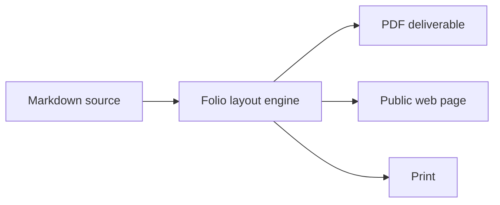

# Folio

### Write in Markdown. Deliver in print.

Series B · October 2026

Carlos Rivera · Founder & CEO · carlos@folio.example

<!-- pagebreak -->

## Final documents are stuck in the paste-up era

- Word processors weld content to styling — every proposal, report, and deck is hand-formatted, every time.
- Docs-as-code produces clean source but embarrassing output; the last mile is a screenshot or a LaTeX ordeal.
- Teams ship PDFs by copy-paste: branding drifts, versions multiply, and nobody is sure which file is final.
- Skilled people lose hours a week to formatting — work that adds nothing and is discarded on the next revision.

<!-- pagebreak -->

## Markdown became the substrate. The last mile didn't.

- Markdown quietly won written work: readmes, docs sites, notes, specs — and now most AI output.
- Every model writes Markdown natively. Prose generation became effectively free.
- Yet the branded, paginated deliverable — the thing you actually send a client — still lives in Word and InDesign.
- Presentation is now the bottleneck. That is the wedge.

<!-- pagebreak -->

## Folio: one Markdown file, print-quality documents

- Markdown stays the source of truth — readable in any editor, diffable in git, portable forever.
- A live paginated engine typesets it: real pages, themes, running headers, footers, page numbers.
- What you preview is what ships — one command exports a pixel-identical PDF.

<!-- pagebreak -->

## What ships today

| Area | Capabilities |
|---|---|
| Layout | Live A4 portrait & landscape preview, dark pages, footnotes, equations |
| Design | Seven bundled themes, named style library, font & palette editor, per-document overrides |
| Content | Mermaid diagrams, syntax-highlighted code, tables, tasks, captioned images |
| Workflow | Inspector with issues & revision compare, draft recovery, multi-window editing |
| AI | Built-in MCP server — agents read, edit, and style documents directly |
| Publishing | One-click public website with landing page and changelog |

<!-- pagebreak -->

## Documents agents can typeset

- Folio ships an MCP server: AI assistants open documents, apply named styles, and edit structure — not raw keystrokes.
- An agent drafts the statement of work; Folio guarantees it lands on-brand, paginated, and exportable.
- Every MCP client is a distribution channel we do not pay for.
- AI-native from the file format up: Markdown in, finished document out.

<!-- pagebreak -->

## Market

| Layer | Segment | Size |
|---|---|---|
| TAM | Office & documentation software | $34B |
| SAM | Branded document output for distributed teams | $4.6B |
| SOM | Agencies, consultancies, technical studios | $340M |

- Wedge: the knowledge workers who write in Markdown but still deliver PDFs.
- Expansion: Publish hosting turns one-off seats into recurring site revenue.

<!-- pagebreak -->

## Business model

| Plan | Price | Included |
|---|---|---|
| Solo | $10 / month | Full editor, themes, PDF export |
| Studio | $24 / user / month | Shared style library, brand locking, Publish sites |
| Fleet | Custom | SSO, procurement, dedicated support |

- 81% gross margin; blended ACV $1,850 and rising with Publish attach.
- Land as a single editor seat, expand into the team's document layer.

<!-- dark -->

## Traction

| Metric | Today | Trajectory |
|---|---|---|
| ARR | $12.6M | 3.2× year over year |
| Paying customers | 6,800 | up from 2,100 a year ago |
| Monthly active writers | 94,000 | 61% from organic & template gallery |
| Net revenue retention | 124% | driven by seat and Publish expansion |
| Gross margin | 81% | up from 74% |

<!-- /dark -->

## Who pays

- **Studios & agencies** — brand-sensitive deliverables: proposals, SOWs, client reports.
- **Consultancies & technical firms** — documentation that ships with the work.
- **Independent professionals** — invoices, reports, and one-pagers with taste.

> "We replaced a designer-week per proposal. Folio pays for itself before lunch." — Principal, 40-person consultancy

> "The first tool where our Markdown docs and our client PDFs are the same artifact." — Head of Docs, developer tools company

<!-- pagebreak -->

## Why we win

| | Folio | Google Docs | Notion | Word | Typst/LaTeX |
|---|---|---|---|---|---|
| Markdown source of truth | ✓ | — | — | — | ✓ |
| Print-quality pagination | ✓ | — | — | ✓ | ✓ |
| Brand themes & style library | ✓ | Partial | — | Partial | — |
| Native desktop, offline-first | ✓ | — | — | ✓ | ✓ |
| Agent API (MCP) built in | ✓ | — | — | — | — |

The others treat formatting as a feature. We treat it as the product.

<!-- pagebreak -->

## Go-to-market

- **Template gallery** — free, indexed starters that rank and convert; each one is a Folio document.
- **Publish** — every hosted site carries a "Made with Folio" link: the product distributes itself.
- **MCP ecosystem** — agents recommend tools they can drive; Folio is the one they can typeset in.
- **Team pull-up** — Solo users bring Folio into teams; Studio seats follow the first shared proposal.

<!-- pagebreak -->

## Financial plan

| | FY2024 | FY2025 | FY2026E | FY2027P | FY2028P |
|---|---|---|---|---|---|
| ARR ($M) | 1.1 | 3.9 | 14.0 | 27 | 52 |
| Net new ARR ($M) | — | 2.8 | 10.1 | 13 | 25 |
| Gross margin | 68% | 74% | 81% | 84% | 86% |
| Headcount | 6 | 11 | 18 | 34 | 52 |

- Efficient by design: burn multiple 0.8, CAC payback 11 months.
- This round funds the path to $50M ARR without a follow-on.

<!-- pagebreak -->

## Team

- **Carlos Rivera — Founder & CEO.** Built the product and grew it to $4M ARR as the sole maintainer; 18 people today.
- **Engineering (9)** — Electron, CodeMirror, and Paged.js veterans from document tooling.
- **Design (5)** — typography-first; the moat is taste, and it does not outsource.
- **Developer relations (4)** — template gallery, Publish ecosystem, MCP integrations.

<!-- pagebreak -->

## The ask: $30M Series B

- **Raising $30M** to reach **$50M ARR** and default-alive economics within 24 months.
- **45% engineering** — layout engine, web viewer, Windows, real-time collaboration.
- **30% go-to-market** — template gallery, Publish partnerships, enterprise readiness.
- **15% design** — theme foundry, the compounding brand asset.
- **10% operations** — security, compliance, hiring.

Milestones: $27M ARR and 84% gross margin by end of FY2027; Publish live on 20,000 sites.

<!-- pagebreak -->

# Print is a feature. Markdown is the substrate.

Folio — Series B · October 2026

Carlos Rivera · carlos@folio.example

*Sample deck authored in Folio with the editorial theme. Company metrics are illustrative.*
