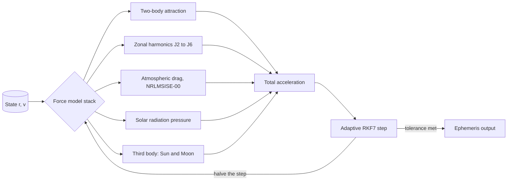
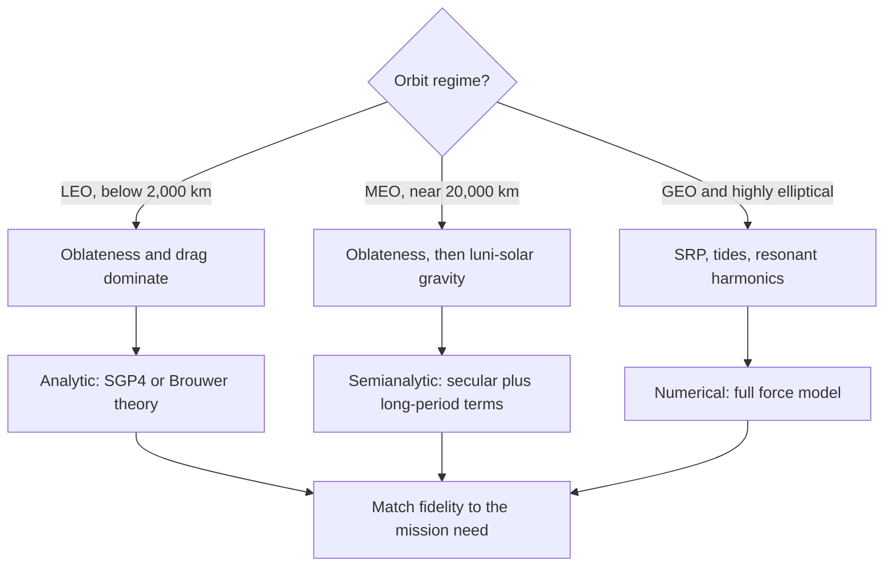

# Orbital Perturbation Models for Low-Earth-Orbit Mission Design

## 1. Introduction

Kepler's two-body problem gives mission designers the melody: closed ellipses,
periods fixed by the semi-major axis, and a geometry simple enough to sing from
memory. Real spacecraft, however, fly through a gravitational field that is
not a point mass, an atmosphere that does not end abruptly, and a neighborhood
that includes a massive Moon and an insistent Sun. The slow drift these
perturbations impose — a few degrees of nodal regression per day at low
altitudes — is not noise to be ignored but a design variable to be played.

Classical treatments organize the field by magnitude and timescale [1, 3].
This sample article follows that tradition in miniature: Section 2 writes the
equations of motion, Section 3 derives the secular rates caused by oblateness,
Section 4 reviews the non-gravitational forces, and Sections 5 and 6 sketch a
numerical propagation pipeline and selection guidance for force models.

## 2. Equations of motion

The perturbed two-body problem is written as the Keplerian acceleration plus a
disturbing acceleration $\boldsymbol{a}_d$:

$$
\ddot{\boldsymbol{r}} = -\frac{\mu}{r^{3}}\,\boldsymbol{r}
  + \boldsymbol{a}_{J_2}
  + \boldsymbol{a}_{\mathrm{drag}}
  + \boldsymbol{a}_{\mathrm{SRP}}
  + \boldsymbol{a}_{\mathrm{3B}},
$$

Here $n = \sqrt{\mu / a^{3}}$ is the mean motion and $p = a(1-e^{2})$ the semilatus rectum. Every term beyond the first is smaller than it by at least three orders of
magnitude in low Earth orbit, yet each accumulates secularly over a mission
lifetime. Table 1 compares the regimes where the individual terms dominate
and the modeling approach each regime rewards.[^orders]

| Regime | Dominant perturbations | Typical order | Recommended approach |
|:-------|:-----------------------|:--------------|:---------------------|
| LEO, below 2,000 km | Oblateness $J_2$, atmospheric drag | 10⁻²–10⁻³ m/s² | SGP4, or numerical with drag |
| MEO, near 20,000 km | Oblateness, then luni-solar gravity | 10⁻⁴–10⁻⁵ m/s² | Semianalytic, Brouwer-type |
| GEO, 35,786 km | SRP, luni-solar pull, resonances | 10⁻⁶–10⁻⁷ m/s² | Numerical, full force model |

*Table 1 — Perturbation regimes and the force models they reward.*

## 3. Secular effects of oblateness

The Earth's equatorial bulge is the loudest perturbation in low orbit. To
first order in the zonal harmonic $J_2 \approx 1.083 \times 10^{-3}$, the
nodal regression and apsidal precession rates of a near-circular orbit are
[1, 4, 5]:

$$
\dot{\Omega} = -\tfrac{3}{2}\, n\, J_2
  \left(\frac{R_\oplus}{p}\right)^{2} \cos i,
$$

$$
\dot{\omega} = \tfrac{3}{4}\, n\, J_2
  \left(\frac{R_\oplus}{p}\right)^{2} \left(5\cos^{2} i - 1\right).
$$

The nodal rate vanishes at the critical inclination $i \approx 63.4°$, where
$5\cos^2 i = 1$, and reverses sign in retrograde orbits. Constellations
exploit both signs: a prograde shell at $53°$ drifts westward as a unit, while
the sun-synchronous condition

$$
\dot{\Omega} \approx +0.9856\ ^\circ\!\text{/day}
$$

selects a retrograde inclination near $97.5°$ at 550 km altitude, keeping the
orbit plane fixed against the Sun. Table 2 evaluates the secular rate for a
circular reference orbit with $a = 6{,}928$ km and $e = 0$.

| Inclination $i$ | Nodal drift (°/day) | Sense |
|----------------:|--------------------:|:------|
| 30° | −6.46 | Westward, fast |
| 53° | −4.49 | Westward, constellation shell |
| 90° | 0.00 | Polar, frozen node |
| 97.5° | +0.97 | Eastward, sun-synchronous |
| 120° | +3.74 | Eastward, retrograde |

*Table 2 — Secular nodal regression for a circular orbit at 550 km altitude.*

## 4. Non-gravitational perturbations

Atmospheric drag removes energy along the velocity vector. For a near-circular
orbit with ballistic coefficient $C_D A / m$ flying through density $\rho$,
the semi-major axis decays at [1, 6]

$$
\dot{a} = -\rho\,\frac{C_D A}{m}\, n\, a^{2},
\qquad
\tau \;\approx\; \frac{a}{\lvert \dot{a} \rvert},
$$

where $\tau$ estimates the orbital lifetime. Solar radiation pressure, in the
cannonball approximation, is independent of altitude:

$$
\lVert \boldsymbol{a}_{\mathrm{SRP}} \rVert = P_\odot\, \frac{C_R A}{m},
\qquad
P_\odot \approx 4.56 \times 10^{-6}\ \mathrm{N/m^{2}},
$$

and the tidal pull of a third body of gravitational parameter $\mu_3$ at
distance $R_3$ grows linearly with the spacecraft radius vector:

$$
\lVert \boldsymbol{a}_{\mathrm{3B}} \rVert \;\approx\; \mu_3\, \frac{r}{R_3^{3}}.
$$

Near geostationary altitude the lunar and solar tides overtake every other
perturbation except radiation pressure and the resonant harmonics of the
geopotential, which is why geostationary missions buy station-keeping
budgets rather than frozen orbits.

## 5. Numerical propagation pipeline

Special perturbations integrate the equations of motion directly, assigning
each force to a model of matched fidelity [2]. Figure 1 sketches the loop:
the state is handed to a force model stack, the total acceleration steps an
adaptive integrator, and the step is retried at finer resolution until the
local error tolerance is met.

*Figure 1 — The numerical propagation loop assembles a force model, steps an adaptive integrator, and refines until the local error tolerance is met.*

## 6. Model selection guidance

Analytical theories trade fidelity for speed: SGP4 reads a mean-element
token and returns a position in microseconds, semianalytical theories
average the secular rates and correct the long-period terms, and full
numerical integration spends microseconds per step to keep every force in
tune. Figure 2 summarizes the conventional assignment.

*Figure 2 — Model selection by regime: the dominant perturbations dictate the cheapest theory that still meets the accuracy budget.*

The choice is economic rather than musical. A conjunction screen over
millions of catalog objects uses SGP4 because it must; a landing burn uses
numerical integration because it may not fail.

## 7. Conclusion

Perturbation models turn the two-body melody into an arrangement: oblateness
sets the tempo through secular drift, drag dims the closing bars, and
radiation pressure and tides add the quiet accompaniment that separates a
working mission from a textbook exercise. The two-column layout shown here —
full-width abstract, columned body, spanning tables and figures — carries the
argument the way a journal would print it.

## Acknowledgments

The authors thank an anonymous reviewer for asking whether the reference
orbit was tuned by ear. B. May's doctoral thesis on zodiacal dust predates
this collaboration by several decades.[^may]

## References

1. Vallado, D. A. (2013). *Fundamentals of Astrodynamics and Applications* (4th ed.). Microcosm Press.
2. Montenbruck, O., & Gill, E. (2000). *Satellite Orbits: Models, Methods, and Applications*. Springer.
3. Bate, R. R., Mueller, D. D., & White, J. E. (1971). *Fundamentals of Astrodynamics*. Dover.
4. Brouwer, D. (1959). Solution of the problem of artificial satellite theory without drag. *The Astronomical Journal*, 64, 378–397.
5. Kozai, Y. (1959). The motion of a close Earth satellite. *The Astronomical Journal*, 64, 387–397.
6. Lane, M. H., & Cranford, K. H. (1969). An improved analytical drag theory for the artificial satellite problem. *AIAA Paper 69-925*.

[^orders]: Orders of magnitude assume circular orbits and representative area-to-mass ratios; they locate regimes, not budgets.
[^may]: The remaining authors' orbits are self-taught.
